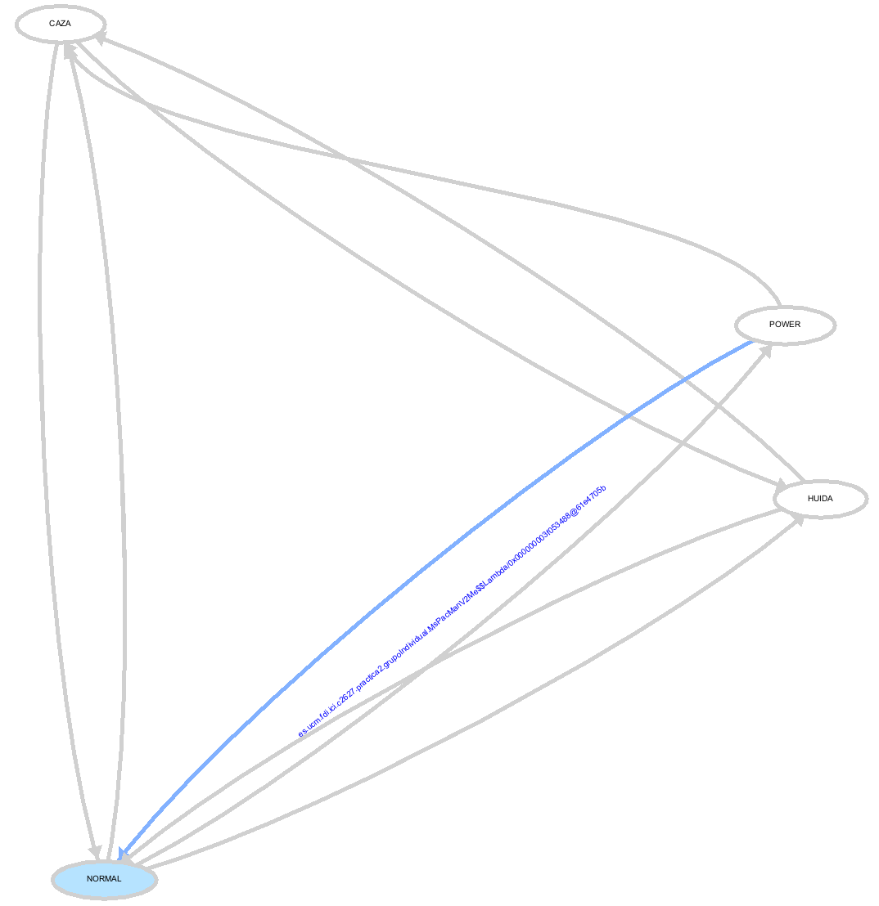
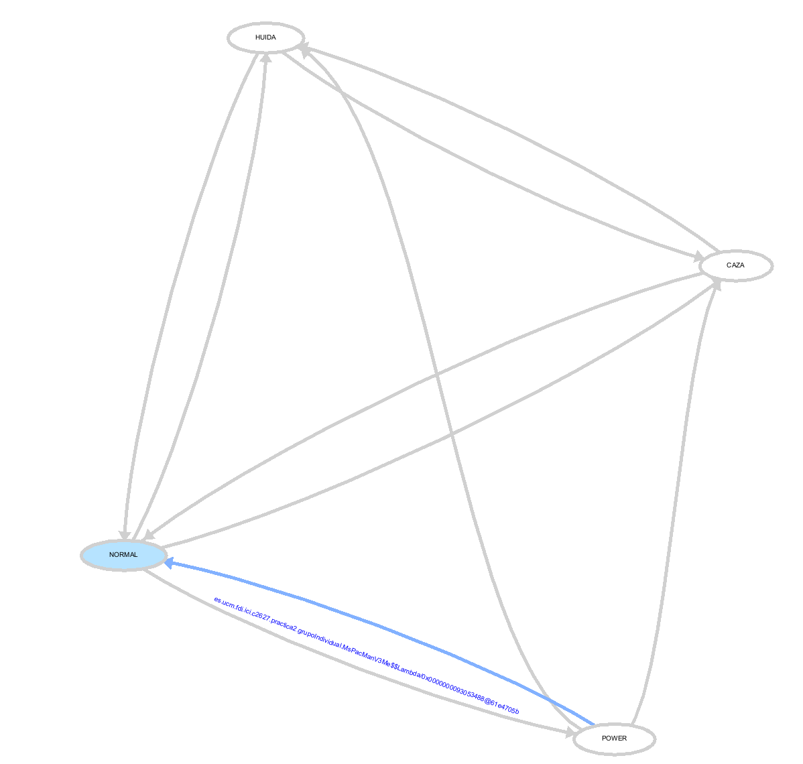
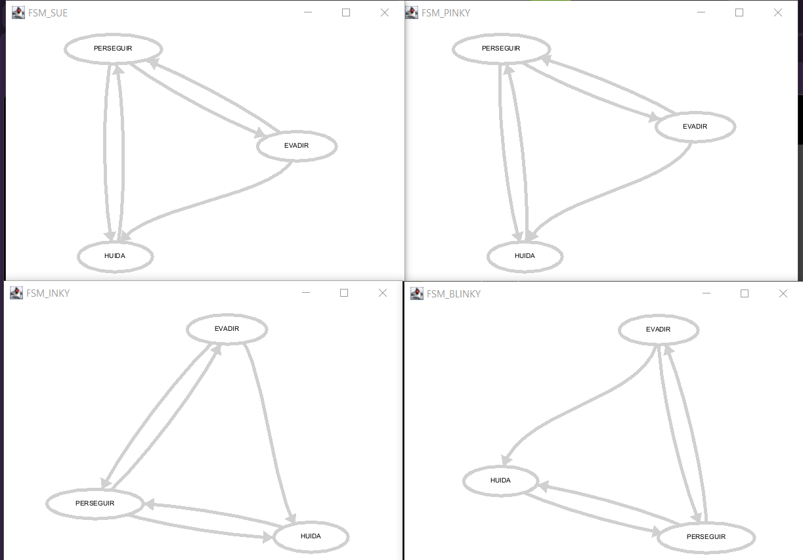

# PARTE DE LA REENTREGA

**Viernes 6 de Noviembre del 2026 (DEL SWITCH A LA MAQUINA)**

**MsPacManV2**

Contenido/Cambios: Se aplica la librería fsm para transformar la lógica de decisión en una máquina de estados. Se han creado 3 clases para su uso: MsPacManV2Me (controlador), MsPacManState (estados) y MsPacManInput (extracción de variables). Se mantienen los estados anteriores (CAZA, POWER, HUIDA, NORMAL).

IA:Si, se pidio una base para transformar el código del MsPacmanV0Me (el cual usaba un switch y condiciones if/else) a una máquina de estados usando la librería fsm de la asignatura, creando las clases Input y State necesarias asegurando que la lógica de los costes y las transiciones se mantuvieran idénticas.

La IA proporcionó la estructura base de la FSM, la clase MsPacManInput (con el método parseInput() precalculando los booleanos) y la clase MsPacManState implementando la interfaz State.

Tuvimos que adaptar las transiciones al orden exacto de los if de mi detectarFase original para asegurar que el comportamiento fuera idéntico. Además, añadí el GraphFSMObserver y me di cuenta de que era necesario llamar a showInFrame() explícitamente para poder visualizarlo.

**Promt usado**: 

Creame tres codigos base usando las siguientes librerias: es.ucm.fdi.ici.fsm.State, es.ucm.fdi.ici.Input y es.ucm.fdi.ici.fsm.FSM, tomando este código del controlador MsPacmanV0Me para transformarlo a una máquina de estados con los siguientes nombres: MsPacManV2Me, MsPacManState y MsPacManInput. No me cambies el nombre de los métodos que estaban ya del MsPacManV0Me a excepcion de sus firmas para recibir Fase (de MsPacManState) como prámetro en decidirConLookahead, costeDe y combinarCoste además su cuerpo en getMove para delegar en fsm.run(in).

Dentro de MsPacManState quiero que implemente State y con un constructor con la fase (un enum Fase con NORMAL, CAZA, POWER, HUIDA) y el controlador que la usa junto con un getter de la fase en el que esta y en MOVE execute haz que devuelva del controlador el resultado de decidir(game, fase) siendo game dado por el MsPacManInput.

Dentro de MsPacManInput que extiende de Input, en su parseInput() debe calcular los hechos booleanos que consumirán las transiciones de la FSM, sustituyendo así al antiguo detectarFaseP del V0:

* hayComestibleCerca() → hay algún fantasma comestible a distancia ≤ CERCA (30).

* hayFantasmaNoComestiblePegado() → hay algún fantasma no comestible a distancia ≤ HOLGURA (6).

* hayFantasmaCerca() → hay algún fantasma no comestible a distancia ≤ HOLGURA (6). Se usa para histéresis de salida de HUIDA.

* hayPowerPillYFantasmas() → quedan power pills activas y todos los fantasmas están en la guarida (getGhostLairTime(g) > 0).

Estos métodos booleanos serán públicos y las constantes que se usan son CERCA = 30, HOLGURA = 6.

Por último dentro de MsPacManV2Me que extiende de PacmanController tiene que tener un Constructor que construye la FSM (construirFSM()), con los cuatro estados (stateNormal, stateCaza, statePower, stateHuida) y las nueve transiciones siguientes, con histéresis:

* NORMAL → CAZA si hayComestibleCerca

* NORMAL → HUIDA si hayFantasmaNoComestiblePegado

* NORMAL → POWER si hayPowerPillYFantasmas

* CAZA → HUIDA si hayFantasmaNoComestiblePegado

* CAZA → NORMAL si !hayComestibleCerca

* POWER → CAZA si hayComestibleCerca

* POWER → NORMAL si !hayPowerPillYFantasmas

* HUIDA → CAZA si hayComestibleCerca

* HUIDA → NORMAL si !hayFantasmaNoComestiblePegado (o !hayFantasmaCerca si se quiere histéresis completa)

Junto con los métodos:
public void preCompute(String opponent) → fsm.reset()
public MOVE decidir(Game game, Fase fase) (llamado por PacmanState.execute), tiene el cuerpo antiguo de getMove del MsPacManV0Me
El getMove de este tendrá que asegurar los buffers y ejecutar el estado actual con la máquina de estados fsm.run(in) siendo in el MsPacManInput;

Añade también dentro de MsPacManV2Me un GraphFSMObserver que me imprima la máquina de estados con showInFrame(new Dimension(500, 350)); usando las librerias de es.ucm.fdi.ici.fsm.observers.* y es.ucm.fdi.ici.fsm.Transition.

```
===== PACMAN V0 =====
GHOST V0 | Media: 6635.4 | Min: 1370.0 | Max: 15420.0 | Desv.: 3257.814598651015 | N: 50
GHOST V0 Ticks | Media: 2176.64 | Min: 79.0 | Max: 4001.0 | Desv.: 1461.0331647746498 | N: 50

===== PACMAN V2 =====
GHOST V2 | Media: 6999.8 | Min: 1610.0 | Max: 23310.0 | Desv.: 3872.0012702392924 | N: 50
GHOST V2 Ticks | Media: 2144.62 | Min: 103.0 | Max: 4001.0 | Desv.: 1489.957592739896 | N: 50

===== COMPARACIÓN V0 vs V2 =====

Métrica: GHOST V0
Media V0: 6635.4
Media V2: 6999.8
Diferencia V2 - V0: 364.40000000000055
Error típico de la diferencia: 715.6221041292446
Diferencia / error típico: 0.5092073007490393

Métrica: GHOST V0 Ticks
Media V0: 2176.64
Media V2: 2144.62
Diferencia V2 - V0: -32.01999999999998
Error típico de la diferencia: 295.11325069317695
Diferencia / error típico: 0.108500719384134

50 partidas por versión y rival, semillas 1 a 50, comparando Ms. Pac-Man.


== puntos: v2 frente a v0 (más es mejor) ==
rival                        v0               v2         D   2·ET_D
Basico               7642 ± 396       8258 ± 448      +616     1197  ruido
Intermedio           6399 ± 372       6431 ± 501       +32     1249  ruido
Avanzado             3173 ± 202       3032 ± 187      -141      551  ruido
------------------------------------------------------------------------
MEDIA (3)            5738 ± 193       5907 ± 233      +169      605  ruido
v2 es mejor contra 0 rivales, peor contra 0 y no se distingue contra 3.

== turnos por vida: v2 frente a v0 (más es mejor) ==
rival                        v0               v2         D   2·ET_D
Basico               1566 ± 166       1669 ± 162      +103      463  ruido
Intermedio           1986 ± 189       1582 ± 182      -404      524  ruido
Avanzado               542 ± 34         611 ± 81       +69      176  ruido
------------------------------------------------------------------------
MEDIA (3)             1364 ± 84        1288 ± 86       -77      241  ruido
v2 es mejor contra 0 rivales, peor contra 0 y no se distingue contra 3.

== fantasmas comidos: v2 frente a v0 (más es mejor) ==
rival                        v0               v2         D   2·ET_D
Basico              8,20 ± 0,53      9,04 ± 0,60     +0,84     1,60  ruido
Intermedio          7,34 ± 0,46      7,10 ± 0,60     -0,24     1,52  ruido
Avanzado            3,26 ± 0,33      2,78 ± 0,31     -0,48     0,90  ruido
------------------------------------------------------------------------
MEDIA (3)           6,27 ± 0,26      6,31 ± 0,30     +0,04     0,80  ruido
v2 es mejor contra 0 rivales, peor contra 0 y no se distingue contra 3.

```
Los resultados son estadísticamente idénticos (todo es "ruido"), lo que confirma que la refactorización a la FSM ha sido exitosa y el comportamiento es el mismo que el de la versión original.

Resultados del FSMObserver



**MsPacManV3 (HUIR CON MEMORIA)**

Contenido/Cambios:
Se implementa una histéresis en el estado de HUIDA añadiendo un umbral de salida distinto al de entrada en MsPacManInput (HOLGURA_SALIDA_HUIDA = 10, la HOLGURA que estaba antes pasa a llamarse HOLGURA_ENTRADA_HUIDA = 6). Se mantiene el resto de la FSM intacto.

Además de esto también creamos una clase base para reusar el MsPacmanState en vez de crear otro ya que anteriormente este iba por versión de controlador del pacman, ahora con esta clase base que herederaran los pacmans con fsm y no será necesario modificar o crear otro State para el pacman. Porque dentro de PacmanController no tiene el método de decidir;

Clase MsPacManBase:

```
package es.ucm.fdi.ici.c2627.practica2.GIRM_LC;

import pacman.controllers.PacmanController;
import pacman.game.Constants.MOVE;
import pacman.game.Constants.GHOST;
import pacman.game.Game;
import pacman.game.GameView;
import java.awt.Color;
import java.util.ArrayDeque;
import java.util.Arrays;
import java.util.Deque;

import es.ucm.fdi.ici.fsm.FSM;
import es.ucm.fdi.ici.fsm.Transition;
import es.ucm.fdi.ici.c2627.practica2.GIRM_LC.MsPacManState.Fase;

public class MsPacManBase extends PacmanController {
	
    @Override
    public MOVE getMove(Game game, long timeDue) {
        return null;
    }
    
    public MOVE decidir(Game game, Fase fase) {
    	return null;
    }
    
    @Override
    public String getName() { return "MsPacManBase"; }
}

```

IA: no

Hipotesis
Al usar el mismo umbral (HOLGURA = 6) para entrar y salir de HUIDA, la FSM entra y sale cada turno cuando el fantasma está justo a 6 por lo tanto se añde un umbral de salida mayor (HOLGURA_SALIDA_HUIDA = 10). Ahora entra a distancia 6, pero no sale hasta que el fantasma se aleja a distancia 10. Esto da una "memoria" que estabiliza el comportamiento.
Resultado: En el GraphFSMObserver se ve que las transiciones son mucho más limpias y no parpadean. En la tabla de Comparar, la puntuación debería mejorar ligeramente al evitar que Pac-Man se quede atascado en zonas de peligro dudando si huir o no.

```
== puntos: v3 frente a v2 (más es mejor) ==
rival                        v2               v3         D   2·ET_D
Basico               7256 ± 177       7647 ± 175      +392      498  ruido
Intermedio           6950 ± 198       6871 ± 200       -79      564  ruido
Avanzado              3263 ± 73        3119 ± 71      -144      204  ruido
------------------------------------------------------------------------
MEDIA (3)             5823 ± 92        5879 ± 92       +56      260  ruido
v3 es mejor contra 0 rivales, peor contra 0 y no se distingue contra 3.

== turnos por vida: v3 frente a v2 (más es mejor) ==
rival                        v2               v3         D   2·ET_D
Basico                1604 ± 68        1605 ± 66        +1      189  ruido
Intermedio            1754 ± 76        1708 ± 73       -46      211  ruido
Avanzado               620 ± 28         582 ± 26       -38       77  ruido
------------------------------------------------------------------------
MEDIA (3)             1326 ± 35        1298 ± 34       -28       98  ruido
v3 es mejor contra 0 rivales, peor contra 0 y no se distingue contra 3.

== fantasmas comidos: v3 frente a v2 (más es mejor) ==
rival                        v2               v3         D   2·ET_D
Basico              7,81 ± 0,23      8,26 ± 0,22     +0,46     0,63  ruido
Intermedio          7,91 ± 0,25      7,88 ± 0,25     -0,03     0,71  ruido
Avanzado            3,31 ± 0,12      3,08 ± 0,12     -0,22     0,35  ruido
------------------------------------------------------------------------
MEDIA (3)           6,34 ± 0,12      6,41 ± 0,12     +0,07     0,34  ruido
v3 es mejor contra 0 rivales, peor contra 0 y no se distingue contra 3.
```

Aunque los resultados estadísticos sigan siendo "ruido" (no hay una mejora significativa en los números), en el GraphFSMObserver se observa que las transiciones son mucho más limpias y no parpadean. Se evita que Pac-Man se quede atascado en zonas de peligro dudando si huir o no, aunque esto no se traduzca en una puntuación drásticamente mayor contra estos rivales.

Resultados del FSMObserver



**Viernes 7 de Noviembre del 2026 (DEL SWITCH A LA MAQUINA)**

**GhostV1**

Cambios/Contenido: Se transforma el controlador de fantasmas GhostsV0Me para usar una FSM por cada fantasma (usando un EnumMap<GHOST, FSM>). Se crean las clases GhostsV1, GhostsState y GhostsInput.

IA: Si, también se pidio una base para transformar el código del GhostsV0Me para usar una FSM por cada fantasma, teniendo en cuenta que cada fantasma debe tener su propia máquina de estados independiente. De aqui se le pidió que no añadiese el estado NORMAL ya que nunca caía en tal estado.

También se le pidio instancir 4 FSM independientes para cada fantasma y añadir los observadores correspondientes.

Tuvimos que envolver el método de getMove() en un bloque try-catch para capturar los NullPointerException y comprobar el getGhostLairTime antes de pedir el nodo actual. 

**Promt usado**:
Creame tres codigos base usando las siguientes librerias: es.ucm.fdi.ici.fsm.State, es.ucm.fdi.ici.Input y es.ucm.fdi.ici.fsm.FSM, tomando este código del controlador GhostsV0Me para transformarlo a una máquina de estados con los siguientes nombres: GhostsV1, GhostsState y GhostsInput.

No me cambies el nombre de los métodos que ya estaban en GhostsV0Me salvo detectarFase(que ya no será necesario), actualizarEstados; este devuelve MOVE con un cuerpo de switch por cada estado siendo estos:

* HUIDA->huirConCriterio(...);
* EVADIR->movimientoDispersar(...);
* PERSEGUIR->segunSuPapel(...);

Dentro de GhostState que implementa State contiene un enum público llamado FaseG con PERSEGUIR, EVADIR y HUIDA, en su constructor se guarda la fase, el controlador y el fantasma al que se aplica. Se tiene también un getter de la fase actual en su MOVE execute se retorna actualizarEstado(game,fase,fantasma) del controlador donde game se obtiene de GhostsInput.

Detro de GhostsInput que exiende de Input en su constructor se guarda el fantasma y se tiene un getter de este. En su parseInput calcula 3 booleados que sustituye el detectarFase del GhostsV0Me:

* esComestible() → game.isGhostEdible(fantasma).

* pacmanCerca() → distancia mínima entre el fantasma y Pac-Man ≤ DISTANCIA_PACMAN_CERCA (10).

* necesitanDispersarse() → hay al menos 2 fantasmas activos (fuera de la guarida, con nodo válido) y algún par de ellos está a distancia < DISTANCIA_MINIMA_FANTASMAS (5). Es la traducción directa de necesitanDispersarse(Game) del V0, pero evaluada una sola vez por turno (no por fantasma).

Estos métodos booleanos son públicos, se tiene las constantes de DISTANCIA_PACMAN_CERCA = 10.0 y DISTANCIA_MINIMA_FANTASMAS = 5.0 y si eel fantasm esta en la guarida (getGhostLairTime(fantasma) > 0) o su nodo es -1, se pone los 3 booleanos a falso.

Dentro de GhostsV1 que exitende de GhostController se pantiene el EnumMap<GHOST, MOVE> moves y se implementa un FSM for cada fantasma usando EnumMap<GHOST, FSM> fsms. En el contructor del controlador, se llama a construirFSM(f) para cada f de GHOST.values().

Para construir la máquina de estados se crea una FSM("FSM_" + f.name()), le añade un GraphFSMObserver propio (guardado en EnumMap<GHOST, GraphFSMObserver> grafos), crea los tres estados (sPerseguir, sEvadir, sHuida, todos GhostsState con el fantasma f y el controlador this) y añade las cinco transiciones siguientes, con histéresis:

* PERSEGUIR → HUIDA si esComestible()

* EVADIR → HUIDA si esComestible()

* HUIDA → PERSEGUIR si !esComestible()

* EVADIR → PERSEGUIR si pacmanCerca()

* PERSEGUIR → EVADIR si !pacmanCerca() && necesitanDispersarse()

y termina con un fsm.ready(sPerseguir) al final de construirFSM además de llamar a grafo.showInFrame(...).

Dentro del getMove(...) por cada ghost si no necesita acción se la slta, si esta en la guarida o si su nodo es -1 se pone moves.put(f, MOVE.NEUTRAL) y continue sino entonces se crea GhostsInput in = new GhostsInput(game, f), ejecutar fsms.get(f).run(in) y moves.put(f, mov).

El resto de los métodos de GhostsV0Me pasan al GhostV1 (segunSuPapel, primerMovimientoDe, proximoCruceDe, huirConCriterio, movimientoAleatorioLegal, movimientoDispersar y puntuacionDispersion)

Hipótesis sobre NORMAL: En GhostsV0Me el estado NORMAL era inalcanzable porque detectarFase siempre devolvía PERSEGUIR, HUIDA o EVADIR.
Decisión: No lo hemos incluido como estado en la FSM de V1. En su lugar, las transiciones base terminan siempre en PERSEGUIR y este estado ejecuta el método segunSuPapel(). Hacer esto es funcionalmente idéntico a la versión anterior, ya que la acción a ejecutar era exactamente la misma, pero limpia el grafo de la FSM eliminando un estado fantasma que nunca se activaba.

Resultado: La tabla de Comparar da los mismos resultados exactos que GhostsV0Me (mismas semillas, mismos rivales), pero el GraphFSMObserver muestra un grafo mucho más limpio y sin ramas muertas.

50 partidas por versión y rival, semillas 1 a 50, comparando fantasmas.

```
== puntos: v1 frente a v0 (menos es mejor) ==
rival                        v0               v1         D   2·ET_D
Basico               1898 ± 139       2229 ± 160      +331      423  ruido
Intermedio           4567 ± 306       4156 ± 418      -411     1035  ruido
Avanzado             8519 ± 407      10980 ± 517     +2461     1315  peor
------------------------------------------------------------------------
MEDIA (3)            4995 ± 176       5788 ± 228      +794      576  peor
v1 es mejor contra 0 rivales, peor contra 1 y no se distingue contra 2.

== turnos por vida: v1 frente a v0 (menos es mejor) ==
rival                        v0               v1         D   2·ET_D
Basico                405 ± 105        440 ± 105       +35      297  ruido
Intermedio           1926 ± 206       3013 ± 190     +1086      560  peor
Avanzado             1688 ± 169       2216 ± 184      +528      499  peor
------------------------------------------------------------------------
MEDIA (3)             1340 ± 96        1890 ± 95      +550      269  peor
v1 es mejor contra 0 rivales, peor contra 2 y no se distingue contra 1.

== fantasmas comidos: v1 frente a v0 (menos es mejor) ==
rival                        v0               v1         D   2·ET_D
Basico              1,38 ± 0,23      2,02 ± 0,27     +0,64     0,71  ruido
Intermedio          4,94 ± 0,43      4,40 ± 0,57     -0,54     1,43  ruido
Avanzado           11,56 ± 0,54     14,48 ± 0,64     +2,92     1,67  peor
------------------------------------------------------------------------
MEDIA (3)           5,96 ± 0,24      6,97 ± 0,30     +1,01     0,77  peor
v1 es mejor contra 0 rivales, peor contra 1 y no se distingue contra 2.
```

Los resultados muestran que V1 es ligeramente peor que V0 contra el rival Avanzado. La causa probable de este empeoramiento es por el uso de Math.random() en la estrategia de SUE.

Resultados del FSMObserver

